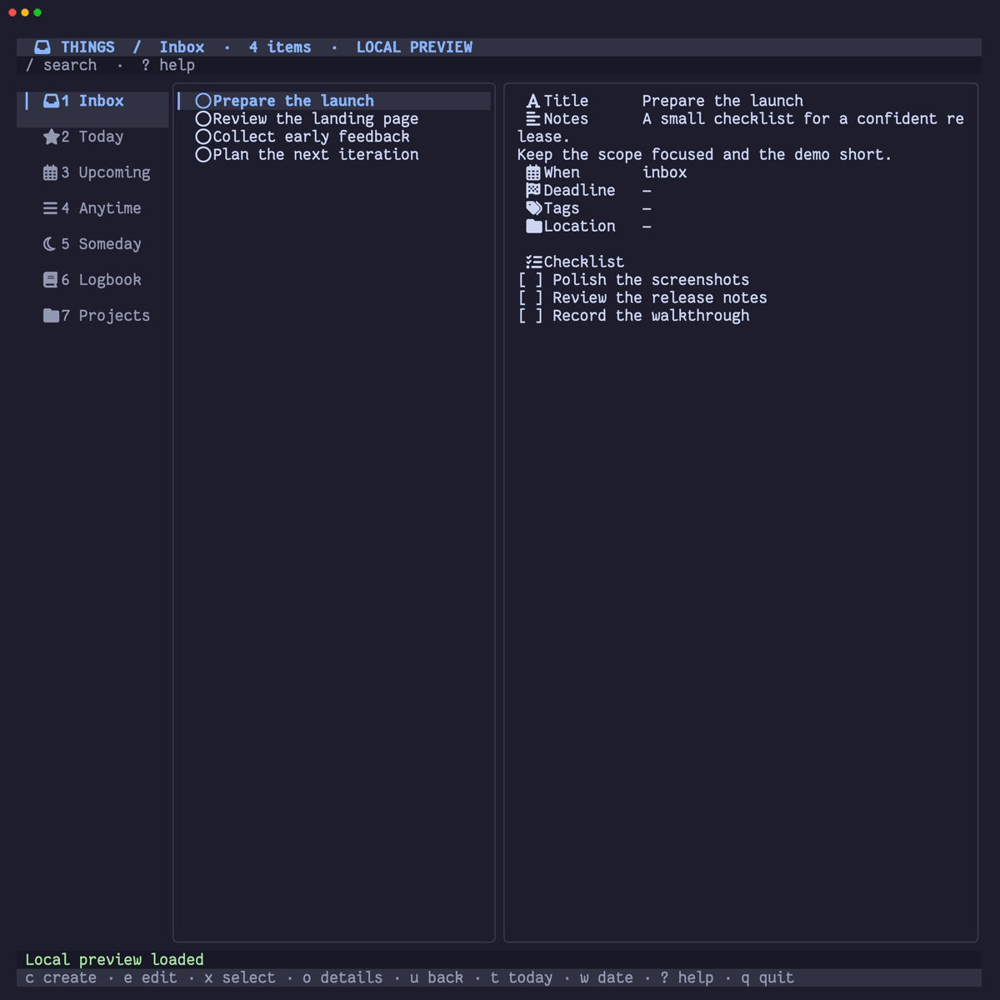

# things3-cloud-tui

[](https://github.com/mh1412/things3-cloud-tui/actions/workflows/main.yml)

A Rust command-line client for [Things 3](https://culturedcode.com/things/)
that talks directly to the Things Cloud API.

This project is a TUI-focused fork of
[evanpurkhiser/things3-cloud](https://github.com/evanpurkhiser/things3-cloud),
created by [Evan Purkhiser](https://github.com/evanpurkhiser).
The original project provides the foundation: the Rust CLI, Things Cloud client,
sync and cache infrastructure, and task-management commands.
This fork builds on that work with an interactive terminal interface,
keyboard-driven editing, autosave, and batch actions.

Thanks to Evan and the upstream contributors for making this project possible.
The original [MIT license](LICENSE) and copyright notice are retained.

Protocol reference: [Things Cloud API documentation](doc/README.md).

## TUI demo

Browse Inbox and Today, view and edit task details,
and schedule tasks with the calendar picker.
Recorded with synthetic tasks in local-preview mode.



[Watch or download the MP4](.github/assets/things3-tui.mp4).

```bash
things3 find --query "rent" --deadline "<=2026-03-31"
things3 new "Follow up with team" --when today
things3 schedule <task-id> --deadline 2026-04-10
things3 mark <task-id> --done
```

## Install

### Prebuilt binaries

Download the archive for your platform from the
[latest release](https://github.com/mh1412/things3-cloud-tui/releases/latest):

| Platform | Archive suffix in the latest release |
| --- | --- |
| macOS — Apple Silicon (ARM64) | `macos-arm64.tar.gz` |
| macOS — Intel (AMD64) | `macos-amd64.tar.gz` |
| Linux — ARM64 | `linux-arm64.tar.gz` |
| Linux — AMD64 / x86-64 | `linux-amd64.tar.gz` |
| Windows — AMD64 / x86-64 | `windows-amd64.zip` |

Each archive contains the `things3` executable and license.
Extract it and place the executable on your `PATH`.
For example, after downloading the macOS ARM64 archive into the current
directory:

```bash
tar -xzf things3-v0.10.3-macos-arm64.tar.gz
mkdir -p ~/.local/bin
install -m 755 things3 ~/.local/bin/things3
export PATH="$HOME/.local/bin:$PATH"
things3 tui --help
```

Add that `PATH` setting to your shell configuration to keep it across sessions.
Linux binaries are built on Ubuntu 22.04 with glibc.
Release assets include `SHA256SUMS`;
verify downloaded archives with `shasum -a 256` on macOS or `sha256sum` on Linux
and compare with the published checksums.

### Build from this repository

Requires Git and the latest stable [Rust toolchain](https://rustup.rs/)
(including Cargo).

```bash
cargo install --git https://github.com/mh1412/things3-cloud-tui.git --branch main --locked things3-cloud
```

The Cargo package is still named `things3-cloud`;
the repository URL above installs **this TUI fork**.
The executable is named `things3` and is installed in Cargo's binary directory
(normally `~/.cargo/bin`).
Ensure that directory is on your `PATH`.

### From a local checkout

```bash
git clone https://github.com/mh1412/things3-cloud-tui.git
cd things3-cloud-tui
cargo install --path . --locked
```

To try the TUI from the checkout without installing:

```bash
cargo run --locked -- tui
```

### Update or replace a Cargo installation

```bash
cargo install --git https://github.com/mh1412/things3-cloud-tui.git --branch main --locked --force things3-cloud
```

If you also have another `things3` installed,
use `command -v things3` to check which executable your shell resolves.
You can launch this installation directly with `~/.cargo/bin/things3 tui`
when using Cargo's default installation directory.

### Terminal font

**The default TUI icon mode requires a
[Nerd Font](https://www.nerdfonts.com/).**
Install a patched font such as FantasqueSansM Nerd Font
or JetBrainsMono Nerd Font,
then select it in your terminal application's profile settings.
Installing the font alone does not change the terminal's active font.

For example, in iTerm2, open **Settings → Profiles → Text → Font**
and choose the Nerd Font.
Missing or incorrect fonts can display icons as boxes or cause alignment issues.

If you prefer not to install a Nerd Font, use plain-text icons:

```bash
things3 tui --icons plain
```

Or use `things3 tui --icons emoji` with a terminal/font that supports emoji.
The demo uses **FantasqueSansM Nerd Font**.

### Launch

```bash
things3 set-auth
things3 tui
```

## Configure auth

```bash
things3 set-auth
```

You can also set credentials via environment variables:

```bash
export THINGS3_EMAIL="you@example.com"
export THINGS3_PASSWORD="your-password"
```

Environment variables override values in the auth file.

## Interactive mode

```bash
things3 tui
things3 tui --view inbox
things3 tui --icons emoji
things3 tui --icons plain
things3 --no-sync tui
```

Browse Inbox, Today, Upcoming, Anytime, Someday, Logbook, and Projects.
The dark theme includes colored panels, focus and selection highlights,
and status colors.
Nerd Font icons are enabled by default: select a Nerd Font
(such as JetBrainsMono Nerd Font) in your terminal's font settings.
Use `--icons emoji` for emoji or `--icons plain` for text symbols.
The global `--no-color` option uses your terminal's default colors.
Wide terminals show task details alongside the list; on smaller terminals,
press `Enter` or `d` to see notes, dates, tags, and checklists.

| Key | Action |
| --- | --- |
| `1`–`7`, `Tab`, `←` / `→` | Switch lists |
| `j` / `k`, `↓` / `↑` | Move the cursor |
| `c` / `e` | Quick create / edit details |
| `x` | Toggle selection of the cursor task |
| `* a` / `* n` | Select all visible tasks / clear selection |
| `y` / `v` / `-` | Complete / reopen / cancel (`!` also cancels) |
| `t` / `s` / `#` | Schedule today / someday / trash |
| `w` | Open calendar to schedule selected tasks (or the focused task) |
| `g i`, `g t`, `g a`, `g s`, `g l`, `g p` | Jump to Inbox, Today, Anytime, Someday, Logbook, Projects |
| `Home` / `End`, `PgUp` / `PgDn` | Jump through the list |
| `o` / `Enter` | View task details or open a project |
| `e` | Enter detail edit mode |
| `/` | Search the current list, including notes and checklists |
| `Enter` / `Esc` while searching | Keep / clear the filter |
| `Space` | Complete or reopen the selected task |
| `Shift-J` / `Shift-K` | Move selected tasks (or the focused task) down / up |
| `Ctrl-D` / `Ctrl-U` | Scroll task details down / up |
| `u` / `Esc` | Clear the filter or go back |
| `r` | Refresh |
| `?` | Show help |
| `q` / `Ctrl-C` | Quit |

Cloud operations run in a background worker.
Changes appear locally immediately and are queued in memory,
then saved together after two seconds without keyboard activity.
Repeated edits to the same item are combined.
The status bar distinguishes pending changes from saved changes.
Refresh and quit flush the queue first; failed saves retain the queue,
and a failed quit-save keeps the TUI open.
Status changes use the same validation as `mark`.
As with other commands, `--no-sync` skips cloud reads but still permits writes.

Actions apply to selected tasks, or the cursor task when nothing is selected.
Each batch is validated in full before entering the save queue.
Changing lists clears the selection.

Selected rows are highlighted.
Reordering moves each selected block one row down/up
while preserving relative order and selection.
Without a selection, it moves the focused task.
Reordering stays within containers;
Upcoming preserves date groups and Logbook stays date-ordered.

Press `c` to type a title directly above the list.
`Enter` creates the task; `Esc` cancels.
The new task stays focused, so press `e` to add details.

Details have **view** and **edit** modes in the same panel.
On wide terminals, opening details focuses the existing right-hand panel;
on narrow terminals, it fills the screen.

In view mode, `j/k` or arrows move between fields and checklist items.
`Space` toggles the focused checklist item done/open; `y` completes it,
`v` reopens it, and `-` cancels it.
`t` schedules Today, `s` schedules Someday, and `w` opens the calendar
(for the deadline when that field is focused, otherwise for scheduling).
`e` enters edit mode; `u`/`Esc` returns to the list.

On a checklist item, `Shift-J` / `Shift-K` moves it down / up,
keeping focus on the moved item.
Checklist order autosaves with the other detail changes.
It includes title, multiline notes, schedule, deadline, tags,
project/area location, and checklist titles and statuses.
Use `Tab`/`Shift-Tab` to switch fields and `Ctrl-U` to clear a field.
Edits automatically enter the save queue after a brief pause;
no save shortcut is required.
`Esc` returns to view mode while keeping edits
(`Ctrl-S` remains an optional equivalent).
In notes, `Enter` inserts a newline.
`Ctrl-N` adds a checklist item, `Ctrl-D` removes the focused item,
and `Ctrl-T` cycles its status.
Failed saves keep the editor open.
Invalid fields must be corrected before leaving.
Project metadata editing is not included.

Idle saves refresh cloud history first.
If another device advances history before the commit,
the TUI refreshes and retries once; failed retries keep the pending queue.

In the calendar, arrows (or `h/j/k/l`) move by day/week, `PgUp`/`PgDn`
(or `[`/`]`) change months, and `t` jumps to Today.
`Enter` applies the date; `Esc`/`u` goes back.
In details, `Ctrl-P` opens the calendar for the deadline when
that field is focused, otherwise for the schedule field.

To try the interface with sample data from a source checkout:

```bash
cargo run -- --load-journal tests/fixtures/tui.json tui --view inbox
```

A loaded journal (or `--no-cloud`) enables **local preview**:
status changes stay in memory, and `r` reloads the original fixture/cache.

## Release workflow

Binary builds and releases are manual.
Pushing commits or tags, or publishing a GitHub release,
does not trigger binary builds.
Automatic lint checks remain enabled.
The **Main** and **Release binaries** workflows can still be started manually
from GitHub Actions when needed.
For locally prepared releases,
upload the platform archives and `SHA256SUMS` directly to the release.

## Live cloud tests

Live cloud tests are opt-in for this fork.
Configure repository secrets `THINGS3_LIVE_TEST_EMAIL`
and `THINGS3_LIVE_TEST_PASSWORD` for a dedicated test account,
then run the **Live Cloud Test** workflow manually.
To also run it on pushes,
set the repository variable `THINGS3_LIVE_TEST_ENABLED` to `true`.
Explicitly requested runs still fail if either secret is missing.

## Features

### Keyboard-first navigation

- Inbox, Today, Upcoming, Anytime, Someday, Logbook, and Projects tabs.
- Gmail-style navigation, highlighted multi-selection,
  and list search across titles, notes, and checklists.
- Shared details panel with view/edit modes and a responsive two-pane layout.
- Dark styling with Nerd Font, emoji, or plain-text icons.

### Task and checklist workflows

- Inline quick create, followed by detailed editing when needed.
- Editable titles, notes, tags, project/area location, schedules, and deadlines.
- Calendar picker and quick Today/Someday scheduling.
- Checklist creation, editing, completion, cancellation, and reordering.
- Batch completion, reopening, cancellation, scheduling, and trashing.
- Single-task and multi-selection reordering within supported lists.

### Sync and local preview

- Optimistic local updates and coalesced cloud saves after keyboard inactivity.
- Pending/saved status, retained queues on failure, and stale-history retry.
- Incremental sync and cached reads through the upstream Cloud client.
- Fixture-based local preview for trying workflows and recording demos.

The inherited CLI commands remain available for scripting
and workflows outside the TUI.
Run `things3 --help` or `things3 <command> --help` for their options.

See [the roadmap](ROADMAP.md) for this fork's scope and current gaps.

## Testing

Run all Rust tests:

```bash
cargo test --all-targets
```

The CLI snapshot suite uses `trycmd` test cases in `trycmd/`.

## Related projects

**Things Cloud API clients** (same approach as this project)

- [wbopan/things-cloud-mcp](https://github.com/wbopan/things-cloud-mcp)
  (Go MCP server via Cloud API)
- [arthursoares/things-cloud-sdk](https://github.com/arthursoares/things-cloud-sdk)
  (Go SDK for Things Cloud)

**Local database / URL scheme clients**
(read from local SQLite, write via URL scheme or AppleScript)

- [ossianhempel/things3-cli](https://github.com/ossianhempel/things3-cli)
  (Go CLI, local database)
- [thingsapi/things.py](https://github.com/thingsapi/things.py)
  (Python library, reads database)
- [thingsapi/things-cli](https://github.com/thingsapi/things-cli)
  (Python CLI built on things.py)
- [GarthDB/rust-things3](https://github.com/GarthDB/rust-things3)
  (Rust library and CLI with MCP)

**MCP servers** (local, via AppleScript or URL scheme)

- [drjforrest/mcp-things3](https://github.com/drjforrest/mcp-things3)
  (Python MCP, AppleScript + x-call)
- [rossshannon/Things3-MCP](https://github.com/rossshannon/Things3-MCP)
  (Python MCP with read/write)
